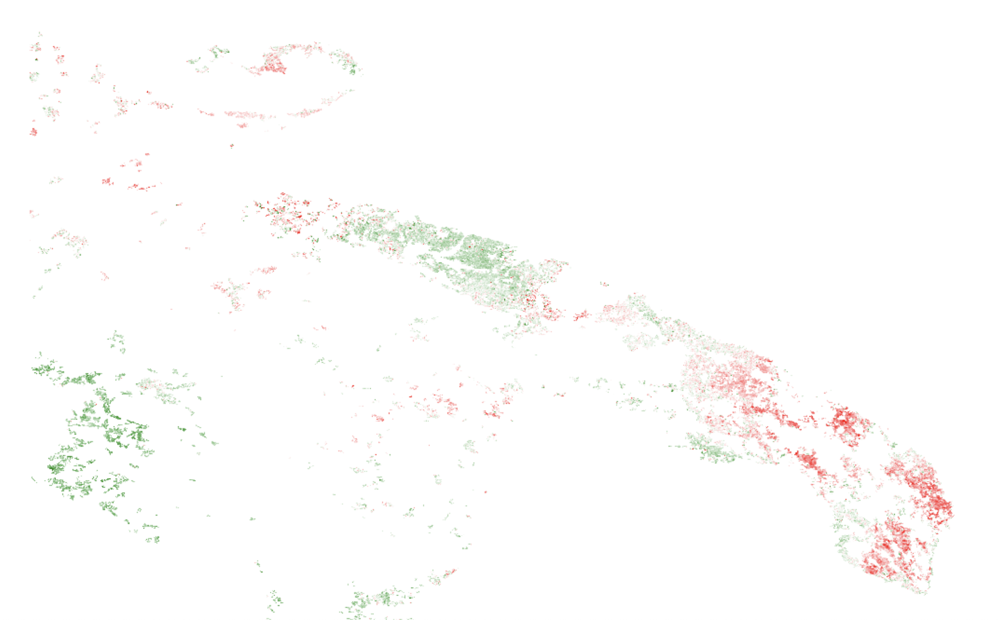

# OliveWatch Puglia

Tracking the decline of Puglia's olive groves from space, using Sentinel-2 satellite imagery (2017–2025) and machine learning.

> Status: 🚧 Week 1 of 11 complete — see [ROADMAP.md](ROADMAP.md)

## Why this project

Since 2013, the bacterium *Xylella fastidiosa* has killed millions of olive trees in Puglia, starting in Salento and moving north towards Bari. It has reshaped the landscape and hit one of the region's core economies. Knowing **where groves are declining and how fast the front is moving** helps focus field monitoring, containment, and replanting, but today this relies largely on slow, expensive field surveys.

Sentinel-2 photographs every point in Puglia every ~5 days at 10 m resolution, for free. This project asks: **can we map olive grove decline across the whole region from those images?**

## The task

For each olive grove parcel and year, classify its health:

| Label | Meaning |
|---|---|
| `0` healthy | Dense, green canopies |
| `1` declining | Thinning crowns, dead branches, patchy brown/grey |
| `2` dead | Grey or bare canopies, or trees removed |

**Input:** 12 monthly Sentinel-2 composites per parcel-year (10 spectral bands + NDVI, NDRE, NDMI), giving `X` of shape `(n_parcel_years, 12, 13)`.
**Labels:** hand-labelled from high-resolution historical imagery in Google Earth Pro, following a written labelling protocol (in progress).

## First look (Week 1)

Mean July NDVI over olive groves (CORINE Land Cover class 223), comparing southern Salento (hit early) with the Bari area (largely unaffected, used as a control):

| Year | Salento | Bari | Difference (Salento − Bari) |
|---|---|---|---|
| 2017 | 0.308 | 0.311 | −0.003 |
| 2018 | 0.411 | 0.389 | +0.021 |
| 2019 | 0.361 | 0.376 | −0.016 |
| 2020 | 0.322 | 0.391 | **−0.070** |
| 2021 | 0.263 | 0.321 | −0.058 |
| 2022 | 0.266 | 0.342 | −0.076 |
| 2023 | 0.330 | 0.367 | −0.037 |
| 2024 | 0.266 | 0.312 | −0.045 |
| 2025 | 0.272 | 0.339 | −0.066 |


*Change in July NDVI, 2017 → 2025. Red = loss of green, white = no change, green = gain.*

**What this shows:**
- **Both areas rise and fall together** (high in 2018, low in 2021 and 2024). That is weather: wet and dry years affect all of Puglia. Comparing two dates directly is misleading, because the change is mostly climate.
- **The difference between the areas removes the shared weather signal.** Salento and Bari are nearly identical until 2019. From 2020 Salento falls behind by 0.04–0.08 and never recovers.
- **On the map, Salento is clearly red** while the Bari–Andria olive belt is stable.
- **Red is not the same as Xylella.** The Gargano also shows losses, but it is outside the infected area. Fire, drought, or land-use change can look similar from space. This is why the project needs hand-made labels and a model, not a single threshold.
- **A single number per year is noisy** (about ±0.02 even without real change), which is why the dataset uses all 12 months rather than July alone.

## Stack

| Stage | Tools |
|---|---|
| Satellite data | Google Earth Engine, Sentinel-2 L2A, CORINE Land Cover |
| Data & features | Python, NumPy, Pandas |
| Baselines | scikit-learn |
| Deep learning | PyTorch (primary), TensorFlow/Keras (parity port) |
| Experiment tracking | MLflow |
| Serving | FastAPI, Docker |
| Deployment | Cloud Run or Hugging Face Spaces |

## Setup

```bash
git clone https://github.com/<your-username>/olivewatch-puglia.git
cd olivewatch-puglia
python -m venv .venv && source .venv/bin/activate
pip install -r requirements.txt
```

Create a `.env` file (never committed):
```
EE_PROJECT=your-earth-engine-project-id
```

Authenticate once with Earth Engine, then run the first exploration:
```bash
earthengine authenticate
python main.py            # connection check
python explore_ndvi.py    # yearly table + change map
```

> macOS with Python from python.org: if you get `CERTIFICATE_VERIFY_FAILED`, run `Install Certificates.command` from `/Applications/Python 3.x/`.

## Design decisions

- **A control region.** Salento is always compared against an unaffected area, so year-to-year weather cancels out.
- **July composites for exploration.** In summer the grass between trees is dry, so most of the remaining green comes from olive canopies.
- **Spatial evaluation (planned).** Neighbouring groves look alike, so train/test splits will be made by geographic area, not at random.

## Limitations

- The model will detect **canopy decline consistent with Xylella's spread**. It does not diagnose the bacterium.
- At 10 m, each pixel mixes 2–4 trees with soil and grass, so individual trees cannot be assessed.
- The CORINE olive mask is from 2018 at 100 m resolution, so some pixels are not olive groves.

## Data sources

- Sentinel-2 Level-2A surface reflectance (Copernicus, ESA), via Google Earth Engine
- CORINE Land Cover 2018 (Copernicus Land Monitoring Service)

Personal, noncommercial project.